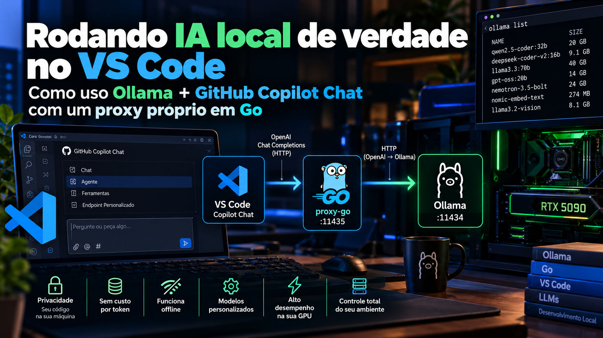
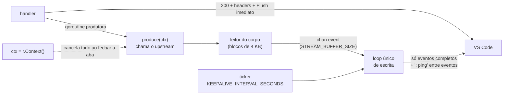
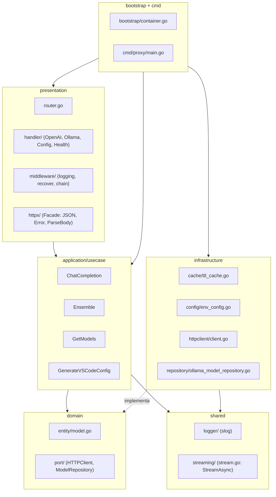
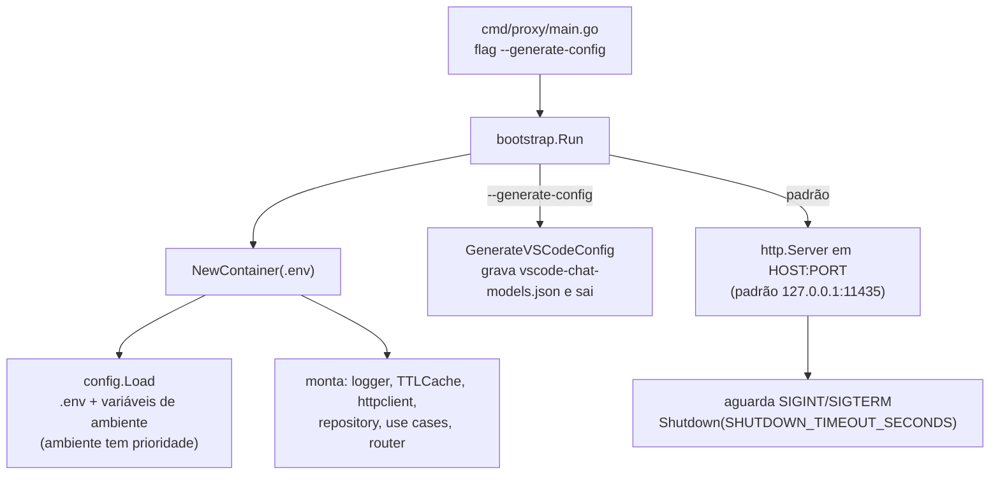
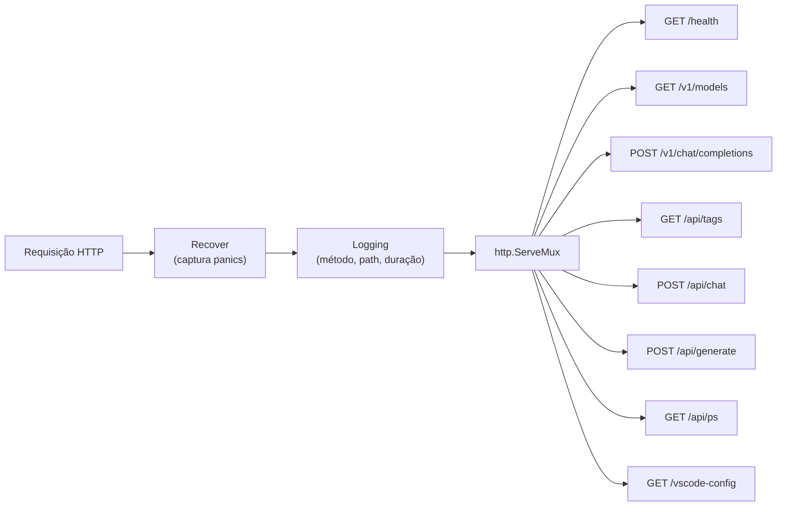
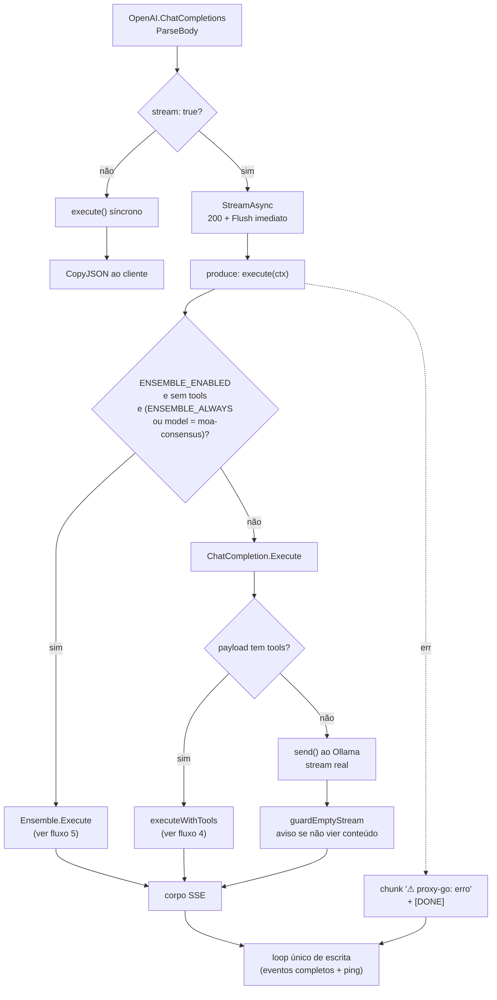
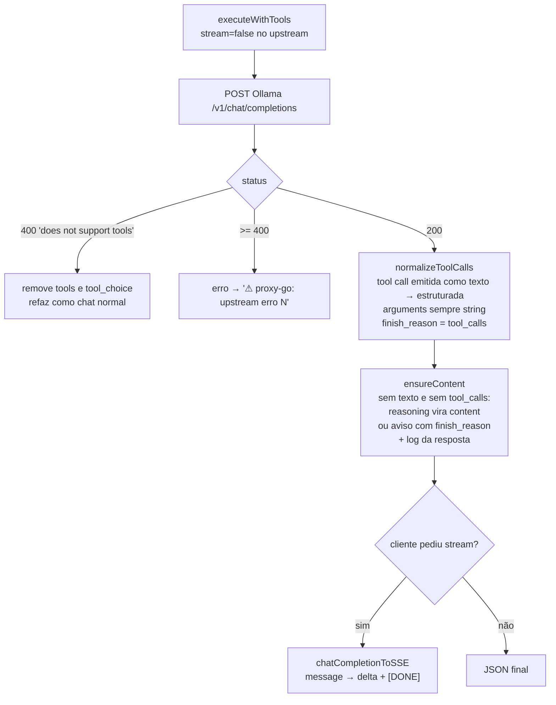
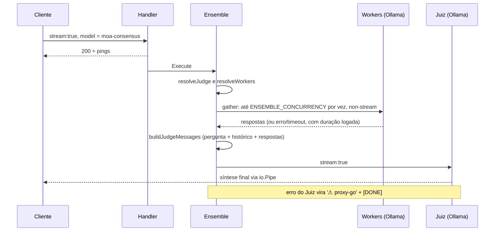
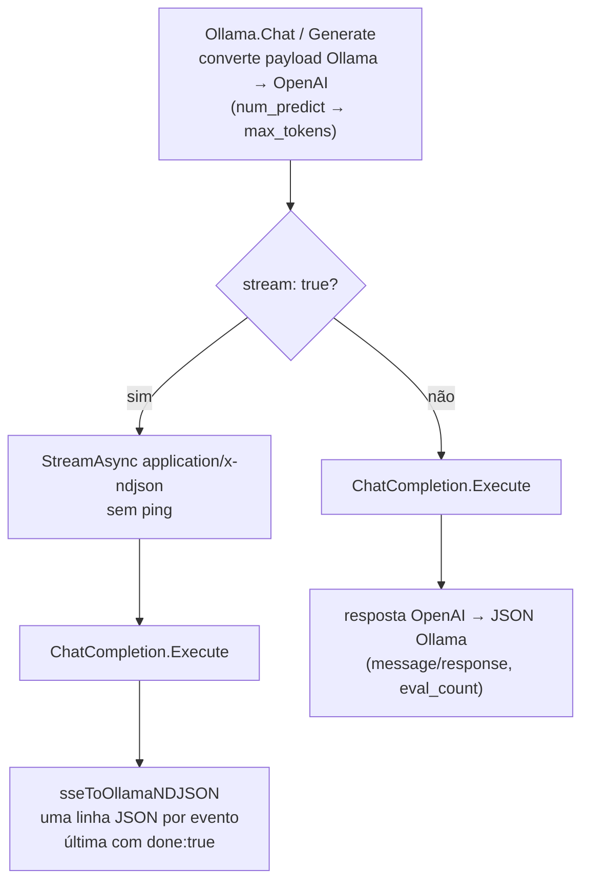
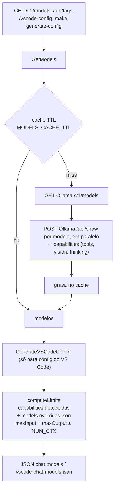

# 🐹 proxy-go — AI Proxy (Go Edition)



> Não é mais um script que você executa. É um **serviço** que fica de pé, sobe junto com o sistema,
> sobrevive a reboot e orquestra cada token da resposta do modelo com a mesma engenharia
> usada em um streamer de áudio/vídeo ao vivo.

**Ambiente de execução preferencial: Linux nativo.** O proxy foi projetado para rodar
direto no host, sem container, sem WSL e sem camadas de virtualização. O binário Go
estático é compilado uma vez e executado como serviço systemd de usuário.

Reescrita completa em **Go**, executada **100% localmente** —
nenhuma dependência de Node, npm ou Docker é necessária no host. Só **Go para compilar**
e o binário resultante rodando direto como serviço do sistema (systemd).

> 📖 A arquitetura completa (a analogia streaming de mídia ↔ streaming de tokens, DDD, SOLID,
> Design Patterns) está detalhada nas seções abaixo — este README é ao mesmo tempo o registro
> de arquitetura e o manual de **uso e operação** do serviço.

---

## 📌 Índice

- [De script para serviço](#-de-script-para-serviço)
- [A engenharia de streaming, resumida](#-a-engenharia-de-streaming-resumida)
- [Arquitetura em camadas](#-arquitetura-em-camadas)
- [Fluxo completo do repositório](#-fluxo-completo-do-repositório)
- [Estrutura de pastas (real, não plano)](#-estrutura-de-pastas-real-não-plano)
- [Pré-requisitos](#-pré-requisitos)
- [Primeiro uso](#-primeiro-uso)
- [Comandos (Makefile)](#-comandos-makefile)
- [Rodando junto com o sistema (restart automático)](#-rodando-junto-com-o-sistema-restart-automático)
- [Endpoints disponíveis](#-endpoints-disponíveis)
- [Configuração (.env)](#-configuração-env)
- [Orquestração de Consenso (Mixture of Agents)](#-orquestração-de-consenso-mixture-of-agents)
- [Gerar configuração do VS Code](#-gerar-configuração-do-vs-code)
- [Adicionar modelos no GitHub Copilot](#-adicionar-modelos-no-github-copilot)
- [Observabilidade](#-observabilidade)
- [Go vs. Node — o que muda na prática](#-go-vs-node--o-que-muda-na-prática)
- [Troubleshooting](#-troubleshooting)
- [Glossário rápido](#-glossário-rápido)

---

## 🔄 De script para serviço

A versão Node era iniciada manualmente (`node index.js`) e morria quando o terminal fechava.
A versão Go tem outra natureza — roda **100% local, direto no host, sem container**:

|                                      | Node (descontinuado)          | Go (este repositório)                                                        |
| ------------------------------------ | --------------------------------------------- | ----------------------------------------------------------------------------- |
| Como inicia                          | `node index.js` no terminal                   | `make install-service` — serviço systemd de usuário em background            |
| O que acontece ao fechar o terminal  | O processo morre                              | Nada — o serviço continua rodando (não depende de terminal/sessão)           |
| O que acontece se a máquina reinicia | Nada — precisa rodar `node index.js` de novo  | O systemd inicia o serviço sozinho no boot (`loginctl enable-linger`)        |
| Onde roda                            | Direto no Node.js instalado no host           | Binário Go estático, compilado e executado direto no host                    |
| Dependências no host                 | Node.js 18+                                   | **Apenas o Go** (para compilar) — nenhum runtime extra, nenhum container     |

Na prática: você configura uma vez (`make install-service`) e esquece. O proxy **está lá**, sempre em `http://localhost:11435`, como qualquer outro serviço de infraestrutura da sua máquina.

---

## 🎞️ A engenharia de streaming, resumida

Quando o modelo responde com `stream: true`, o proxy processa a resposta como um **pipeline de mídia ao vivo**, não como um simples repasse de bytes:



- **Resposta imediata** — [`StreamAsync`](internal/shared/streaming/stream.go) envia `200` + `Content-Type` e faz `Flush()` **antes** de chamar o upstream. O cliente recebe os primeiros bytes em milissegundos, mesmo que o Ollama leve minutos para começar a gerar.
- **Escritor único** — uma goroutine lê o upstream e envia blocos por um `chan` bufferizado (`STREAM_BUFFER_SIZE`, padrão 64); um único `select` escreve no `ResponseWriter`. Não há escrita concorrente, então não há data race.
- **Backpressure real** — se o cliente lê devagar, o `send` no channel bloqueia, a goroutine leitora para de consumir o upstream e o TCP aplica a pressão de volta. Nenhum token é descartado e a memória não cresce sem limite.
- **Enquadramento de eventos** — o loop acumula bytes e só escreve até o último `\n\n` (SSE) ou `\n` (NDJSON). Assim o ping nunca cai no meio de um `data: {...}`.
- **Keep-alive inteligente** — comentário SSE `: ping` a cada `KEEPALIVE_INTERVAL_SECONDS`, só quando ocioso e só em `text/event-stream`. Nunca em NDJSON.
- **Erro visível** — falha depois do `200` (modelo inexistente, OOM, timeout) vira um chunk de texto `⚠ proxy-go: <erro>` seguido de `[DONE]`, em vez de uma resposta vazia.
- **Cancelamento propagado** — o `r.Context()` chega até a chamada ao upstream. Se o usuário fecha a aba, a conexão com o Ollama é fechada e nenhuma goroutine fica presa.

---

## 🏛️ Arquitetura em camadas

Mesma direção de dependência da versão Node (`presentation → application → domain`), com `infrastructure` implementando as _ports_ do domínio via interfaces Go satisfeitas implicitamente:



---

## 🧭 Fluxo completo do repositório

### 1. Inicialização



### 2. Roteamento e middlewares



### 3. `POST /v1/chat/completions` (usado pelo VS Code Copilot)



`ChatCompletion.Execute` sempre aplica `sanitize` antes de enviar: se vierem `temperature` e `top_p` juntos, `top_p` é removido.

### 4. Caminho com `tools` (modo Agente)

O Copilot em modo Agente sempre envia `tools`. O proxy chama o Ollama **sem stream** para poder inspecionar a resposta inteira:



### 5. Orquestração de Consenso (MoA)



Sem workers disponíveis, a pergunta vai direto ao Juiz. Requisições com `tools` nunca entram no MoA.

### 6. Rotas no formato Ollama (`/api/chat`, `/api/generate`)



`GET /api/ps` devolve sempre uma lista vazia, só para não quebrar clientes que fazem polling.

### 7. Modelos e geração de configuração



Se `/api/show` falhar, as capacidades ficam desconhecidas e o gerador assume `toolCalling: true`, ajustável em `models.overrides.json`.

---

## 📁 Estrutura de pastas (real, não plano)

```
proxy-go/
├── cmd/
│   └── proxy/main.go              # entrypoint do servidor HTTP
│
├── internal/
│   ├── bootstrap/
│   │   ├── container.go           # Composition Root — wiring de todas as dependências
│   │   └── application.go         # modo servidor ou CLI --generate-config
│   │
│   ├── domain/                    # núcleo — zero dependências externas
│   │   ├── entity/model.go
│   │   └── port/
│   │       ├── http_client.go
│   │       └── model_repository.go
│   │
│   ├── application/usecase/
│   │   ├── chat_completion.go
│   │   ├── completion_guard.go    # nunca devolve resposta vazia (reasoning → content, aviso)
│   │   ├── tool_calls.go          # normaliza tool calls e converte non-stream → SSE
│   │   ├── ensemble.go            # Orquestração de Consenso (Mixture of Agents)
│   │   ├── get_models.go
│   │   └── generate_vscode_config.go
│   │
│   ├── infrastructure/
│   │   ├── cache/ttl_cache.go
│   │   ├── config/env_config.go
│   │   ├── httpclient/client.go
│   │   └── repository/ollama_model_repository.go
│   │
│   ├── presentation/
│   │   ├── router.go               # http.ServeMux (Go 1.22+, roteamento por método)
│   │   ├── httpx/helper.go         # Facade: JSON, Error, ParseBody, CopyJSON
│   │   ├── middleware/
│   │   │   ├── chain.go
│   │   │   ├── logging.go
│   │   │   └── recover.go
│   │   └── handler/
│   │       ├── openai_handler.go
│   │       ├── ollama_handler.go
│   │       ├── ndjson.go           # SSE OpenAI → NDJSON Ollama
│   │       ├── config_handler.go
│   │       └── health_handler.go
│   │
│   └── shared/
│       ├── logger/logger.go
│       └── streaming/
│           └── stream.go           # StreamAsync: escritor único, enquadramento, ping, erro visível
│
├── deploy/
│   └── proxy-go.service           # unit systemd de usuário (sem Docker)
├── Makefile                        # todos os comandos operacionais (build/start/stop/restart)
├── go.mod
├── .env.example
├── models.overrides.json           # opcional: limites/capacidades por modelo
└── vscode-chat-models.json         # gerado por `make generate-config`
```

---

## ✅ Pré-requisitos

- **Go** instalado no host (para compilar o binário) — veja [go.mod](go.mod) para a versão mínima
- **Ollama** rodando e acessível (padrão `http://localhost:11434`) com os modelos já baixados (`ollama pull ...`)
- Um `.env` preenchido (copie de `.env.example`)

```bash
cp .env.example .env
# edite .env: ajuste OLLAMA_URL, ENSEMBLE_WORKERS e ENSEMBLE_JUDGE conforme seus modelos
```

> Execução 100% local — nenhuma dependência de Docker, Node ou npm. `OLLAMA_URL` aponta
> direto para `http://localhost:11434`, já que proxy e Ollama rodam no mesmo host.

---

## 🚀 Primeiro uso

Para testar rapidamente em primeiro plano, sem instalar nada:

```bash
make run          # go run ./cmd/proxy — lê o .env desta pasta
```

Para rodar como **serviço permanente**, que sobe sozinho com o sistema:

```bash
make install-service
```

Isso compila `./bin/proxy`, grava a unit em `~/.config/systemd/user/proxy-go.service`,
habilita o serviço e liga o _linger_ do usuário (`loginctl enable-linger`), permitindo
o serviço iniciar no boot **sem login interativo**. O proxy fica escutando em
`http://localhost:11435`.

```bash
make logs     # acompanhar os logs em tempo real
```

---

## 🛠️ Comandos (Makefile)

Todo o ciclo de vida do serviço é operado via `make` — tudo local, sem Docker:

| Comando                 | O que faz                                                             |
| ------------------------ | ---------------------------------------------------------------------- |
| `make build`             | Compila o binário em `./bin/proxy`                                     |
| `make run`               | Roda o proxy em primeiro plano (`go run`), sem instalar serviço        |
| `make start`             | Inicia o serviço systemd já instalado                                  |
| `make stop`              | Para o serviço systemd                                                 |
| `make restart`           | **Para, recompila com o código atual e sobe o serviço de novo**        |
| `make status`            | Mostra o status do serviço systemd                                     |
| `make logs`              | Segue os logs do serviço em tempo real                                 |
| `make generate-config`   | Gera `vscode-chat-models.json` **na raiz do projeto**                  |
| `make install-service`   | Compila, instala e habilita o serviço systemd (início automático)      |
| `make uninstall-service` | Remove o serviço systemd                                               |

> `make restart` é o comando do dia a dia: toda vez que você alterar o código Go,
> rode `make restart` para parar o serviço antigo, recompilar e subir a versão nova —
> tudo em um único comando, sem Docker.

---

## 🔁 Rodando junto com o sistema (restart automático)

A unit systemd em [deploy/proxy-go.service](deploy/proxy-go.service) já define
`Restart=on-failure`, e `make install-service` liga o _linger_ do usuário:

```ini
[Service]
Type=simple
ExecStart=__PROJECT_DIR__/bin/proxy
Restart=on-failure
RestartSec=3

[Install]
WantedBy=default.target
```

Isso significa que, uma vez instalado o serviço, o **systemd sobe o proxy automaticamente**
no boot da máquina — sem precisar de login interativo nem de Docker. Se o processo cair
por qualquer motivo, o systemd tenta novamente a cada 3 segundos.

> **Pré-requisito:** o Ollama precisa estar rodando (ex.: o serviço `ollama.service`).
> Como a unit usa `Restart=on-failure`, o proxy tenta novamente caso o Ollama
> ainda não esteja de pé no momento do boot.

Para validar que está tudo certo a qualquer momento:

```bash
make status
curl -s http://localhost:11435/health
```

---

## 🔌 Endpoints disponíveis

| Método | Rota                   | Compatibilidade | Descrição                                                           |
| ------ | ---------------------- | --------------- | ------------------------------------------------------------------- |
| `GET`  | `/health`              | —               | Liveness check                                                      |
| `GET`  | `/v1/models`           | OpenAI          | Lista modelos no formato OpenAI                                     |
| `POST` | `/v1/chat/completions` | OpenAI          | Chat completion — `stream: true` ou consenso MoA (`ENSEMBLE_MODEL`) |
| `GET`  | `/api/tags`            | Ollama          | Lista modelos no formato Ollama                                     |
| `POST` | `/api/chat`            | Ollama          | Chat completion — converte Ollama ↔ OpenAI                          |
| `GET`  | `/vscode-config`       | —               | Retorna o JSON `chat.models` para o VS Code                         |

Rotas idênticas à versão Node — nenhuma integração existente (VS Code, Continue, Cursor) precisa mudar de contrato, apenas apontar para a porta do proxy (`PORT`, padrão `11435`).

---

## ⚙️ Configuração (`.env`)

O proxy encaminha para um **Ollama** local, sem autenticação. Copie `.env.example` para `.env` e ajuste:

| Variável           | Padrão                   | Descrição                                                                            |
| ------------------ | ------------------------ | ------------------------------------------------------------------------------------ |
| `OLLAMA_URL`       | `http://localhost:11434` | URL base do Ollama (upstream) — ambos rodam no mesmo host                           |
| `PORT`             | `11435`                  | Porta local do proxy — diferente da do Ollama (11434) para não conflitar             |
| `MODELS_CACHE_TTL` | `300`                    | Cache de modelos em segundos                                                         |
| `HOST`             | `127.0.0.1`              | Interface onde o proxy escuta (`127.0.0.1` = só esta máquina)                        |
| `NUM_CTX`          | `32768`                  | Contexto do Ollama; o gerador nunca promete `maxInputTokens + maxOutputTokens` maior |
| `MODELS_OVERRIDES_FILE` | `models.overrides.json` | Ajustes por modelo (`maxInputTokens`, `maxOutputTokens`, `toolCalling`, `vision`) |
| `INSECURE_TLS`     | `false`                  | Ignora o certificado só se `OLLAMA_URL` for `https://` com CA interno                |
| `ENSEMBLE_CONCURRENCY` | `1`                  | Consultas simultâneas aos especialistas do MoA                                       |

Variáveis extras, **opcionais**, exclusivas da engenharia de streaming em Go (têm defaults sensatos e não precisam ser definidas):

| Variável                     | Padrão | Descrição                                                               |
| ---------------------------- | ------ | ----------------------------------------------------------------------- |
| `STREAM_BUFFER_SIZE`         | `64`   | Capacidade do channel do pipeline — o tamanho do _jitter buffer_        |
| `KEEPALIVE_INTERVAL_SECONDS` | `15`   | Intervalo do ping SSE de keep-alive                                     |
| `SHUTDOWN_TIMEOUT_SECONDS`   | `10`   | Prazo do graceful shutdown para drenar streams ativos antes de encerrar |

---

## � Orquestração de Consenso (Mixture of Agents)

O proxy expõe um **modelo virtual** (`ENSEMBLE_MODEL`, padrão `moa-consensus`) que
não existe no Ollama — ao selecioná-lo, o proxy aciona um comitê de modelos:

1. **Fan-out** — consulta N modelos especialistas (`ENSEMBLE_WORKERS`) **em paralelo**, cada um limitado por `ENSEMBLE_TIMEOUT_SECONDS`.
2. **Síntese** — um modelo **Juiz** (`ENSEMBLE_JUDGE`) recebe as respostas coletadas e produz uma resposta final, coesa, **em streaming** de volta ao cliente.

Como o proxy retorna imediatamente e o keep-alive SSE roda durante o "pensar" do
comitê, não há timeout enquanto os especialistas respondem; e o `io.Pipe` garante
backpressure real na fase do Juiz.

| Variável                   | Padrão          | Descrição                                                         |
| -------------------------- | --------------- | ----------------------------------------------------------------- |
| `ENSEMBLE_ENABLED`         | `false`         | Liga/desliga a feature                                            |
| `ENSEMBLE_MODEL`           | `moa-consensus` | Nome do modelo virtual que aciona o comitê                        |
| `ENSEMBLE_WORKERS`         | —               | Modelos especialistas consultados em paralelo (separados por `,`) |
| `ENSEMBLE_JUDGE`           | —               | Modelo que sintetiza a resposta final                             |
| `ENSEMBLE_TIMEOUT_SECONDS` | `60`            | Timeout da fase de fan-out                                        |

Exemplo (streaming):

```bash
curl -N http://localhost:11435/v1/chat/completions \
  -H 'Content-Type: application/json' \
  -d '{
    "model": "moa-consensus",
    "stream": true,
    "messages": [{"role":"user","content":"Explique consenso distribuído em 3 frases."}]
  }'
```

Nos logs você verá algo como `ensemble workers_total=3 workers_ok=3 judge=llama3.3:latest`.

---

## 🧾 Gerar configuração do VS Code

Gera o `vscode-chat-models.json` com todos os modelos do Ollama, salvo na raiz do projeto:

```bash
make generate-config
```

Equivalente manual:

```bash
go build -o bin/proxy ./cmd/proxy
./bin/proxy --generate-config
```

O arquivo aparece em `./vscode-chat-models.json`, pronto para colar em `"chat.models"` no `settings.json` — veja o passo a passo em [Adicionar modelos no GitHub Copilot](#-adicionar-modelos-no-github-copilot).

> **Agentes de código:** todos os modelos são expostos com `"toolCalling": true`,
> o que habilita o **modo agente** do Copilot — eles usam ferramentas, leem/editam
> arquivos e **geram código** como qualquer agente nativo. Modelos com visão (ex.:
> `nemotron-3.5-bolt`) recebem `"vision": true` automaticamente.

---

## 🧩 Adicionar modelos no GitHub Copilot

> **Pré-requisito:** o proxy precisa estar rodando (`make start` ou `make run`) na porta `11435`.

1. **Faça login no VS Code com sua conta GitHub** (barra inferior → ícone de conta → Sign in with GitHub)
2. Abra o **Chat do Copilot** (`Ctrl+Alt+I`)
3. No **seletor de modelos** (dropdown no topo do chat), clique e escolha **`Gerenciar Modelos...`**
   - Alternativa: `Ctrl+Shift+P` → `GitHub Copilot: Manage Models` → Enter
4. Clique em **`+ Adicionar Modelos`**
5. Na lista de provedores, escolha **`Custom Endpoint`**
6. Em **API Type**, selecione **`Chat Completions`**
7. Dê **qualquer nome** ao grupo (ex.: `Ollama`)
8. **Deixe a API key em branco** — o Ollama local não exige autenticação
9. Rode `make generate-config`, abra `vscode-chat-models.json` e **cole o conteúdo do array `models`** quando solicitado
10. Os modelos aparecem no seletor — selecione e teste!

**Caminho resumido:**
`Copilot Chat → Seletor de Modelos → Gerenciar Modelos... → + Adicionar Modelos → Custom Endpoint → Chat Completions → (nome) → (sem key) → colar JSON`

---

## 📊 Observabilidade

- **Logs estruturados** — cada requisição é logada via `log/slog` com método, path e duração (`internal/presentation/middleware/logging.go`).
- **Recover de panics** — middleware `recover.go` garante que uma falha em um handler nunca derruba o processo inteiro (equivalente ao `uncaughtException` do Node, mas sem depender de o processo continuar em estado inconsistente).
- **Health check** (`GET /health`) — usado para saber se o serviço está de pé, inclusive em scripts de monitoramento locais.
- **Graceful shutdown** — ao receber `SIGINT`/`SIGTERM`, o servidor aguarda até `SHUTDOWN_TIMEOUT_SECONDS` para os streams ativos drenarem antes de encerrar o processo, evitando cortar respostas em andamento.

---

## ⚖️ Go vs. Node — o que muda na prática

| Aspecto                   | Node.js (descontinuado)                              | Go (este repositório)                                          |
| ------------------------- | ------------------------------------------------------------------- | -------------------------------------------------------------- |
| Concorrência              | Event loop único — 1 tarefa de CPU pode atrasar tudo                | 1 goroutine por requisição, agendadas M:N pelo runtime         |
| Streaming                 | `pipe()` direto do upstream para o cliente                          | Pipeline explícito com channel bufferizado (backpressure real) |
| Cancelamento              | `req.on('close', () => data.destroy?.())` manual em cada controller | `context.Context` propagado automaticamente por toda a cadeia  |
| Deploy                    | Precisa de Node.js instalado no host                                | Binário estático nativo — poucos MB                            |
| Dependências externas     | Nenhuma (stdlib do Node)                                            | Nenhuma (stdlib do Go)                                         |
| Como inicia               | `node index.js` manual                                              | serviço systemd (`make restart`)                               |
| Geração de config VS Code | `node index.js --generate-config`                                   | `make generate-config` (mesmo resultado)                       |

---

## 🛠️ Troubleshooting

| Sintoma                                      | Causa provável                                            | Solução                                                                                |
| -------------------------------------------- | --------------------------------------------------------- | -------------------------------------------------------------------------------------- |
| Chat mostra `No response was returned`       | Modelo só "raciocinou", erro do Ollama ou modelo `:cloud`  | Veja o log (`finish_reason`, `content_len`) e o aviso `⚠ proxy-go:` exibido no chat    |
| Erro de conexão com o upstream               | Ollama não está rodando ou `OLLAMA_URL` errado            | Confirme `ollama list` e ajuste `OLLAMA_URL`                                           |
| `make generate-config` não encontra modelos  | Nenhum modelo baixado no Ollama                           | Rode `ollama pull <modelo>` e tente de novo                                            |
| Streaming trava/corta no meio                | Cliente muito lento e `STREAM_BUFFER_SIZE` pequeno        | Aumente `STREAM_BUFFER_SIZE` no `.env`                                                 |
| Modelos 32B lentos / recarregando            | Contexto do Ollama grande demais para a VRAM              | Defina `OLLAMA_CONTEXT_LENGTH=32768` no serviço do Ollama e `NUM_CTX=32768` no `.env`  |
| Porta `11435` já em uso                      | Outra instância já rodando                                | `make stop` na instância antiga, ou mude `PORT` no `.env`                              |

---

## 📖 Glossário rápido

| Termo                   | Significado                                                                                                       |
| ----------------------- | ----------------------------------------------------------------------------------------------------------------- |
| **Goroutine**           | Unidade de concorrência do Go, agendada pelo runtime; custo inicial ~2KB.                                         |
| **Channel bufferizado** | Fila thread-safe com capacidade fixa — o _jitter buffer_ do pipeline de streaming.                                |
| **Backpressure**        | Lentidão do consumidor se propaga ao produtor, evitando acúmulo ilimitado de dados em memória.                    |
| **context.Context**     | Objeto que carrega cancelamento e prazo através de toda a cadeia de chamadas em Go.                               |
| **Distroless**          | Imagem de container mínima, sem shell nem package manager — menor superfície de ataque.                           |
| **Composition Root**    | Único ponto do sistema (`bootstrap/container.go`) que instancia classes concretas e faz o wiring de dependências. |

---

<div align="center">

**O proxy não é mais algo que rodamos. É um serviço que simplesmente está lá.**

</div>
